# DengueGuard AI — Architecture

Ward-level dengue early warning: weekly weather → per-ward rainfall lags → one model per horizon (2/3/4 weeks) → risk tier + calibrated prediction interval → React dashboard. Everything runs locally from the supplied workbook. There is no external API, no database and no LLM at inference time.

## 1. Data flow

```mermaid
flowchart LR
  X[data/hackathon_preli_dataset.xlsx<br/>31,320 ward-weeks] -->|loader.py<br/>validate · sort · dedupe| CSV[data/dataset.csv]
  CSV -->|features.py<br/>groupby ward_id · shift · rolling| F[As-of feature table<br/>rain lags 1-4, rolling sums,<br/>temp/humidity, recent cases,<br/>ward profile, target-week season]
  F -->|train.py<br/>chronological split| M[(models/trained_model.joblib<br/>model_metadata.json)]
  M -->|engine.py: load once,<br/>batch-score all rows at startup| T[In-memory prediction table<br/>93,240 rows: forecast, interval,<br/>tier, score, eval status]
  T -->|FastAPI /api/*<br/>look-ups + gzip + Cache-Control| API[REST JSON]
  API -->|typed client, in-memory<br/>de-duplicated cache| UI[React UI<br/>Overview · Predictions · Heatmap ·<br/>Weather · Validation]
```

| Step | Module | What happens |
|---|---|---|
| Ingest | `backend/data_processing/loader.py` | Reads the workbook. Checks the 12 expected columns, parses real or Excel-serial dates, and rejects missing values, duplicate `(ward_id, date)` rows and negative counts. Sorts by `ward_id, date` and writes `dataset.csv`. The CSV is rebuilt whenever the XLSX is newer. |
| Lags | `backend/rainfall_lag_pipeline/features.py` | Per-ward `shift(1..4)` rainfall, 2/3/4-week rolling totals, lags 1–4 total, 4-week temperature and humidity means, lag-2 temperature and humidity, recent cases (t, t−1, t−2, 4-week mean), the static ward profile, and sin/cos of the target ISO week. The first 4 weeks of each ward are dropped, so no feature borrows another ward's history (unit-tested). |
| Train | `backend/ml_training/train.py` | One model per horizon h∈{2,3,4}. The target is `dengue_cases` at t+h for the same ward. It selects a model, calibrates intervals and evaluates once on the test years (§2–4). |
| Serve | `backend/prediction_engine/engine.py`, `backend/api/main.py` | Loads artifacts once and scores every (ward, week, horizon) in one vectorised batch, in about 1.5 s. API calls are table look-ups. |
| UI | `frontend/` | Vite + React + TypeScript. City, ward, reference week and horizon live in the URL, so navigation and shared links keep the selection. |

## 2. Chronology-safe validation

Rows are split by **target week**, the week whose cases are predicted:

| Split | Target weeks | Rows per horizon | Used for |
|---|---|---|---|
| Train | 2016-02 → 2022-12 | ≈21,500 | Fitting |
| Validation | 2023 | 3,120 | Model selection and interval calibration |
| Test | 2024 → 2025 | 6,300 | Reported once; never tuned on |

**Leakage controls:**
- Features use only weeks ≤ t of the same ward. A test alters all weeks after t and asserts that the features at t are unchanged.
- The target is attached with `shift(-h)`, and a guard checks that it lands exactly h weeks later.
- Train targets end before validation targets begin, so no training label falls inside a later split.
- Weather after the reference week is never an input. The model forecasts from conditions observed at t.

Each prediction carries an `evaluation_status`: `in_sample_train`, `validation`, `held_out_test` or `forecast_beyond_data`. The UI shows it, so an in-sample fit is never presented as a forecast.

## 3. Model selection

Candidates are compared on 2023 MAE, separately for each horizon:
- HistGradientBoosting with squared-error loss;
- HistGradientBoosting with Poisson loss (counts, 58% zeros);
- a Poisson GLM;
- a 4-week-mean persistence baseline.

**Why HistGradientBoosting:**
- it handles non-linear lag × vulnerability interactions;
- it supports a native categorical city feature;
- it trains in seconds on a CPU;
- the serialized model file is under 1 MB in total.

A deep sequence model was not justified for 60 wards × 522 weeks.

| Horizon | Chosen | Test MAE | Test RMSE | Baseline MAE | 90% PI coverage |
|---|---|---|---|---|---|
| 2 wk | hgb_squared_error | 1.05 | 2.04 | 1.73 | 92.4% |
| 3 wk | hgb_squared_error | 1.06 | 2.06 | 1.94 | 93.9% |
| 4 wk | hgb_poisson | 1.16 | 2.28 | 2.15 | 94.0% |

Grouped permutation importance on the validation year puts **rainfall lags first** for 2- and 3-week horizons. At 4 weeks, seasonality and temperature rise. This matches the breeding-clock lag described in the brief, and it is evidence about this model, not proof of cause.

**Explanation panel:** each forecast shows a local what-if. It re-scores the ward with one factor group set to its training median and reports the change in predicted cases.

## 4. Risk tiers and uncertainty

**Tiers:** predicted weekly cases are mapped using quantiles of training-period ward-weekly cases.

| Tier | Predicted cases / week | Training quantile |
|---|---|---|
| Low | < 2 | below P70 |
| Medium | 2–7 | P70–P85 |
| High | 7–13 | P85–P95 |
| Critical | ≥ 13 | P95 and above |

These are prototype operational tiers, not clinical thresholds.

**Risk score:** `min(100, 100·ŷ / 20)`, where 20 is P99 of training weekly cases. It is a normalised forecast, not a probability.

**Intervals:** Mondrian split-conformal calibration on 2023 residuals.
- Validation predictions are split into 4 quantile bins, because error grows with the forecast.
- Each bin uses the ⌈(n+1)·0.9⌉/n quantile of |residual|.
- The interval is [max(0, ŷ−q), ŷ+q].
- It is a **prediction interval for the weekly count**, not a confidence interval for the mean.
- Empirical coverage on test is 92–94% against 90% nominal. Tests assert lower ≥ 0 and lower ≤ ŷ ≤ upper.

## 5. Compute and cost efficiency

| Control | Effect |
|---|---|
| Serialized models (`joblib`, compressed) loaded once per process | No retraining on requests; cold start ≈ 1.5 s |
| Startup batch scoring of all 93,240 rows | `/predict-all`, `/heatmap` and the alert count are filters, not model calls; typical latency 3–30 ms |
| Memoised explanations (`lru_cache`, 4,096 entries) | 7 extra model calls per new ward/week/horizon, then free |
| Cache invalidation | The engine rebuilds automatically when `trained_model.joblib`'s mtime changes; `dataset.csv` is rebuilt when the XLSX is newer |
| Batched endpoints | `/predict-horizons` returns all 3 horizons in one call; `/predict-all` scores a whole city in one call |
| Client cache | Every GET is memoised and de-duplicated for the session; failures are not cached; filters fire on change, never per keystroke |
| HTTP | gzip above 1 KB; `Cache-Control: private, max-age=300` on API GETs (the data is static) |
| LLM / external APIs | **None at runtime.** Token cost 0, `llm_calls_per_request: 0` (exposed in `/api/metadata`) |

## 6. Resilience

- **Structured errors:** every error returns `{error: {code, message}}`. Codes are `unknown_ward`, `unknown_city`, `invalid_date`, `date_out_of_range`, `invalid_parameter` and `model_unavailable`.
- **Missing or incompatible model:** `/api/health` reports `degraded` and prediction routes return 503 with the retrain command. `start.sh` detects this and retrains (about 20 s).
- **UI states:** each panel has its own loading skeleton, error-with-retry and empty state. A network failure says the API is unreachable rather than showing stale or invented numbers.
- **Scope:** the system is offline-capable by design. There are no rate-limited dependencies, and the frontend bundles its fonts and photos locally.

## 7. Limitations

- **Coverage:** one historical dataset (2016–2025, 60 wards). It is not a live feed, and nothing has been externally validated epidemiologically.
- **No map:** no ward boundary data was supplied, so the heatmap is a ward × horizon / week matrix, not a choropleth.
- **Interval scope:** intervals are marginal per ward-week. City totals in the validation chart sum per-ward bounds, which is a conservative envelope and is labelled as such.
- **Weather inputs:** forecasting beyond the data uses the last observed weather. No weather forecast is ingested.
- **Authentication:** prototype only. PBKDF2-hashed local accounts with in-memory sessions; demo mode needs no account.
