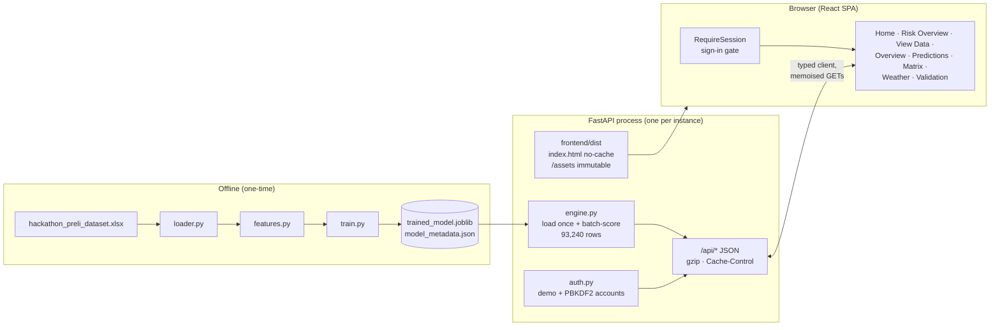
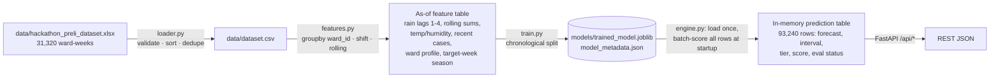
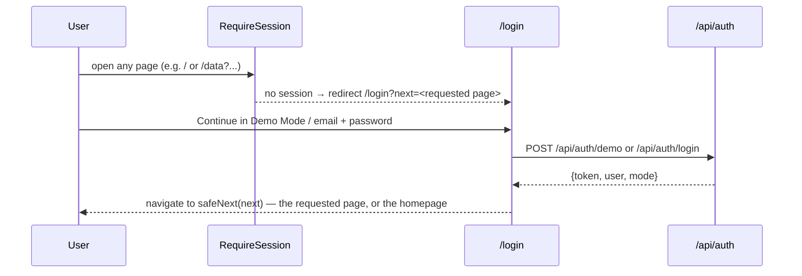
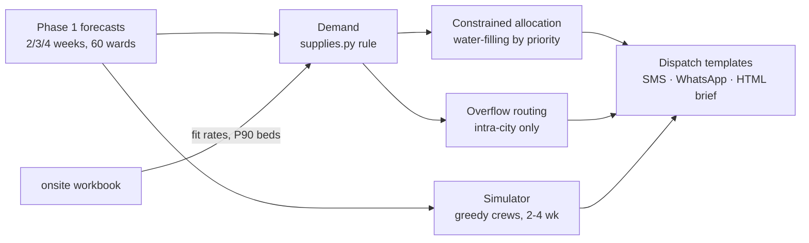

# DengueGuard AI — Architecture

DengueGuard AI is a ward-level dengue early-warning system. It forecasts weekly cases 2, 3 and 4 weeks ahead for each of the 60 wards in the official dataset. The pipeline runs as follows:

1. Weekly weather comes in.
2. It is turned into per-ward rainfall lags.
3. One model per horizon (2/3/4 weeks) makes the forecast.
4. Each forecast gets a risk tier and a calibrated prediction interval.
5. A React dashboard shows the result to sign-in-gated users.

Phase 2 adds an operations layer on top of the forecasts: constrained supply allocation, intra-city hospital overflow routing, a what-if spraying simulator and SMS / WhatsApp / printable dispatch notices (§14).

Everything runs from the supplied workbooks. There is no database, no external API and no LLM at inference time.

**Live deployment:** https://ai-for-urban-dengue-outbreak.vercel.app/
**Repository:** https://github.com/ByteStudiosBD/AI-for-Urban-Dengue-Outbreak

## 1. System overview

The same FastAPI app serves the API and the built frontend from one port: 8000 locally, or one Vercel Python function in production. The browser makes no requests to any other origin at runtime.

## 2. Repository layout

| Path | Role |
|---|---|
| `dengueguard-ai/data/` | Official workbooks `hackathon_preli_dataset.xlsx` (Phase 1) and `bangladesh_dengue_large_dataset_onsite.xlsx` (Phase 2), with the derived `dataset.csv` and `onsite_supplies.csv` caches |
| `dengueguard-ai/backend/data_processing/loader.py` | Ingest, validation and CSV cache |
| `dengueguard-ai/backend/rainfall_lag_pipeline/features.py` | Per-ward lag and rolling features |
| `dengueguard-ai/backend/ml_training/train.py` | Model selection, conformal calibration, test evaluation |
| `dengueguard-ai/backend/prediction_engine/engine.py` | Loads models, batch-scores everything, explanations |
| `dengueguard-ai/backend/api/main.py` | FastAPI routes, error handling, caching, SPA hosting |
| `dengueguard-ai/backend/api/auth.py` | Demo sessions and optional local officer accounts |
| `dengueguard-ai/backend/operations/` | Phase 2: supply rules, allocation, overflow routing, simulator, dispatch templates, export script (§14) |
| `dengueguard-ai/exports/` | Sample SMS, WhatsApp and printable commissioner briefs (generated) |
| `dengueguard-ai/models/` | Serialized models and metadata (under 1 MB) |
| `dengueguard-ai/frontend/` | Vite + React 19 + TypeScript single-page app |
| `dengueguard-ai/tests/` | pytest suite (pipeline + API) and the Playwright browser smoke test |
| `dengueguard-ai/app.py`, `vercel.json`, `.python-version` | Vercel entrypoint and build configuration |
| `dengueguard-ai/start.ps1`, `start.sh`, `dev.sh` | One-command local start (Windows / macOS / Linux) and dev mode |
| `dengueguard-ai/docs/DEMO_SCRIPT.md` | Two-minute live walkthrough for the demo video |

## 3. Data and ML pipeline

| Step | Module | What happens |
|---|---|---|
| Ingest | `loader.py` | Reads the workbook and checks the 12 expected columns. Parses real or Excel-serial dates. Rejects missing values, duplicate `(ward_id, date)` rows and negative counts. Sorts by `ward_id, date` and writes `dataset.csv`, rebuilding it whenever the XLSX is newer. On a read-only filesystem such as Vercel, the CSV write is skipped and the data stays in memory. |
| Lags | `features.py` | All features are computed per ward (summarised in the diagram above). The first 4 weeks of each ward are dropped, so no feature borrows another ward's history; this is unit-tested. |
| Train | `train.py` | One model per horizon h∈{2,3,4}. The target is `dengue_cases` at t+h for the same ward. It selects a model, calibrates intervals and evaluates once on the test years (§4–6). |
| Serve | `engine.py` | Loads the models once and scores every (ward, week, horizon) in one vectorised batch, in about 1.5 s. After that, API calls are table look-ups. |

## 4. Chronology-safe validation

Rows are split by **target week**, the week whose cases are predicted:

| Split | Target weeks | Rows per horizon | Used for |
|---|---|---|---|
| Train | 2016-02 → 2022-12 | ≈21,500 | Fitting |
| Validation | 2023 | 3,120 | Model selection and interval calibration |
| Test | 2024 → 2025 | 6,300 | Reported once; never tuned on |

**Leakage controls:**
- Features use only weeks ≤ t of the same ward. A test alters every week after t and checks that the features at t do not change.
- The target is attached with `shift(-h)`, and a guard checks that it lands exactly h weeks later.
- Train targets end before validation targets begin, so no training label falls inside a later split.
- Weather after the reference week is never an input. The model forecasts from conditions observed at t.

Each prediction carries an `evaluation_status`: `in_sample_train`, `validation`, `held_out_test` or `forecast_beyond_data`. The UI shows it, so an in-sample fit is never presented as a forecast.

## 5. Model selection

The candidates are compared on 2023 MAE, separately for each horizon:
- HistGradientBoosting with squared-error loss;
- HistGradientBoosting with Poisson loss (the data are counts, 58% of them zeros);
- a Poisson GLM;
- a 4-week-mean persistence baseline.

**Why HistGradientBoosting:**
- it handles non-linear interactions between lags and ward vulnerability;
- it supports city as a native categorical feature;
- it trains in seconds on a CPU;
- all the serialized models together are under 1 MB.

A deep sequence model was not justified for 60 wards × 522 weeks.

| Horizon | Chosen | Test MAE | Test RMSE | Baseline MAE | 90% PI coverage |
|---|---|---|---|---|---|
| 2 wk | hgb_squared_error | 1.05 | 2.04 | 1.73 | 92.4% |
| 3 wk | hgb_squared_error | 1.06 | 2.06 | 1.94 | 93.9% |
| 4 wk | hgb_poisson | 1.16 | 2.28 | 2.15 | 94.0% |

Grouped permutation importance on the validation year puts **rainfall lags first** for the 2- and 3-week horizons. At 4 weeks, seasonality and temperature matter more. This matches the breeding-cycle lag described in the brief. It is evidence about this model, not proof of cause.

**Explanation panel:** each forecast comes with a local what-if. The ward is re-scored with one factor group set to its training median, and the panel reports how much the predicted cases change.

## 6. Risk tiers and uncertainty

**Tiers:** predicted weekly cases are mapped to tiers using quantiles of training-period ward-weekly cases.

| Tier | Predicted cases / week | Training quantile |
|---|---|---|
| Low | < 2 | below P70 |
| Medium | 2–7 | P70–P85 |
| High | 7–13 | P85–P95 |
| Critical | ≥ 13 | P95 and above |

These are prototype operational tiers, not clinical thresholds.

**Risk score:** `min(100, 100·ŷ / 20)`, where 20 is P99 of training weekly cases. It is a normalised forecast, not a probability.

**Intervals:** Mondrian split-conformal calibration on 2023 residuals.
- Validation predictions are split into 4 quantile bins, because error grows with the forecast.
- Each bin uses the ⌈(n+1)·0.9⌉/n quantile of |residual|.
- The interval is [max(0, ŷ−q), ŷ+q].
- It is a **prediction interval for the weekly count**, not a confidence interval for the mean.
- Empirical coverage on the test years is 92–94% against 90% nominal. Tests check that lower ≥ 0 and lower ≤ ŷ ≤ upper.

## 7. Backend API

All routes are `GET` unless marked. Every error has the shape `{error: {code, message}}`.

| Route | Returns |
|---|---|
| `/api/health` | `ok` or `degraded` (model missing or incompatible) |
| `/api/metadata` | Wards, cities, date range, model metrics, tier thresholds, `llm_calls_per_request: 0` |
| `/api/observations` | Weekly observed cases and weather for one ward |
| `/api/weather-lags` | Rainfall lag features for one ward and week |
| `/api/records` | Original dataset rows: filtered, sorted and paged on the server; CSV download |
| `/api/predict` | One ward / week / horizon: forecast, interval, tier, score, drivers, observed outcome |
| `/api/predict-horizons` | All three horizons for one ward in one call |
| `/api/predict-all` | Every ward for a week and horizon (all 60, or one city): the Risk Overview tiles |
| `/api/heatmap` | Ward × horizon and ward × recent-week matrices |
| `/api/validation`, `/api/validation-series` | Test metrics and observed-vs-predicted series |
| `/api/ops/assumptions` | Phase 2 supply rates fitted from the onsite workbook (with exact ranges and agreement), per-ward planning capacity, scenario defaults |
| `POST /api/ops/plan` | One scenario: ward allocations and flags, crews, city bed pools, transfers, 2–4-week simulation and ROI ranking (§14) |
| `POST /api/ops/dispatch` | SMS and WhatsApp notices per ward (`lang` = `en` or `bn`) |
| `POST /api/ops/brief` | Printable HTML commissioner brief for one city or all wards |
| `/api/auth/config`, `POST /api/auth/demo`, `POST /api/auth/login`, `/api/auth/me`, `POST /api/auth/logout` | Authentication (§9) |
| `/api/*` (anything else) | Structured 404 |
| `/*` | The built SPA (`frontend/dist`), with `index.html` as the fallback for client routes |

The error codes are `unknown_ward`, `unknown_city`, `invalid_date`, `date_out_of_range`, `invalid_parameter`, `invalid_input`, `invalid_credentials`, `no_accounts`, `no_session`, `not_found` and `model_unavailable`.

## 8. Frontend architecture

**Stack:**
- React 19, TypeScript and Vite;
- Tailwind CSS v4 with `@theme` design tokens;
- Radix primitives (select, popover, tooltip);
- Recharts and Motion;
- React Router;
- locally bundled fonts: Manrope and Noto Sans Bengali.

| Route | Page | Purpose |
|---|---|---|
| `/login` | Sign-in | Demo mode (one click) or officer email/password. Always reachable |
| `/` | Home | Product landing page; **Explore Dashboard** opens Risk Overview |
| `/risk` | Risk Overview | Schematic heatmap: 60 ward tiles grouped by city, coloured by live forecasts; a ward detail panel with Overview, Weather & drivers, Trends and All ward data tabs |
| `/data` | View Data | All 31,320 original records and columns, with sorting, filters, paging and CSV export |
| `/dashboard` | Overview | City summary, KPIs and ward watchlist |
| `/predictions` | Risk Predictions | Horizon comparison for one ward with intervals and drivers |
| `/heatmap` | Risk Matrix (by week) | Ward × horizon and ward × last-8-weeks matrix, which links to predictions |
| `/weather` | Weather Data | Rainfall lag explanation and weather series |
| `/validation` | Model Validation | Chronological split, metrics and observed vs predicted |
| `*` | Not found | Friendly 404 inside the app shell |

**Key design decisions:**
- **Filters live in the URL.** City, ward, reference week (`asOf`) and horizon (`h`) are kept in the query string through `useFilters`. Navigation, reloads and shared links keep the selection.
- **The shell is persistent.** The sidebar and top bar stay mounted while pages change; pages are code-split with `lazyPage`. Each route has an error boundary, so one failing page cannot blank the app.
- **A typed API client** (`services/api.ts`, `types/api.ts`) memoises and de-duplicates every GET for the session, and does not cache failures.
- **Overview colours:**
  - Risk Overview tiles use green for Low, blue for Medium and red for High or Critical.
  - Critical tiles are also striped, outlined and marked "C", so colour is never the only signal.
  - Grey means no prediction.
  - The model and API keep all four tiers, and the ward panel shows the exact one.
- **Internationalisation.** The whole interface is in English and Bangla (`i18n/en.ts`, `i18n/bn.ts`). A typed key set makes the Bangla file mirror the English one at compile time.
- **Theme.** Dark is the default, with a light mode.
  - The toggle stores the choice in `localStorage` (`dg.theme`).
  - An inline script in `index.html` applies the theme before first paint, so there is no flash.
  - Colours are CSS tokens overridden under `:root[data-theme="light"]`.
  - Theme transitions are skipped under `prefers-reduced-motion`.
- **UI states.** Each panel has its own loading skeleton, error-with-retry state and empty state.
- **Footer.** A shared site footer, with a repository link, appears on the public and app pages.

## 9. Authentication and session flow

- **Sign-in comes first.** `RequireSession` guards the homepage and every app route. A visitor with no session is sent to `/login`. The page they asked for is carried in `?next=`, except when it was the plain homepage.
- **After sign-in** the user goes back to the requested page. With no `next`, they land on the **homepage**, not the dashboard.
- **`safeNext`** accepts only same-site paths: it must start with `/`, must not start with `//` and must not point to `/login`. This blocks open redirects.
- **Demo mode** needs no credentials, and the UI labels it as demo mode.
- **Officer accounts** are optional and local. They are created with `python -m backend.api.auth add <email>` and stored in the git-ignored `backend/auth_users.json` as salted PBKDF2-SHA256 hashes (200,000 iterations). With no accounts configured, login returns `no_accounts` instead of pretending to authenticate.
- **Sessions:**
  - The server holds random tokens in memory.
  - The browser stores the session under `dg.session`. It uses `sessionStorage` by default and `localStorage` when **Remember me** is ticked.
  - This is prototype-grade authentication, not production identity management.

## 10. Compute, caching and cost efficiency

| Control | Effect |
|---|---|
| Serialized models (`joblib`, compressed) loaded once per process | No retraining on requests; cold start ≈ 1.5 s |
| Startup batch scoring of all 93,240 rows | `/predict-all`, `/heatmap` and the alert count are filters, not model calls; typical latency 3–30 ms |
| Memoised explanations (`lru_cache`, 4,096 entries) | 7 extra model calls per new ward/week/horizon, then none |
| Automatic invalidation | The engine reloads when `trained_model.joblib`'s mtime changes; `dataset.csv` is rebuilt when the XLSX is newer |
| Batched endpoints | `/predict-horizons` returns 3 horizons in one call; `/predict-all` returns all 60 wards in one call |
| Server-side paging | `/records` filters, sorts and pages in pandas and returns one page (default 50). The browser never downloads the full dataset unless the user asks for the CSV |
| Client cache | GETs are memoised and de-duplicated; filters fire on change, never per keystroke |
| HTTP compression | gzip for responses above 1 KB |
| API caching | `Cache-Control: private, max-age=300` on successful API GETs, because the data is static |
| Frontend caching | `index.html` is served with `no-cache`, so a new deployment is picked up at once. Content-hashed `/assets/*` files are `public, max-age=31536000, immutable`. This fixes the blank page that an old cached `index.html` caused by pointing at deleted asset files |
| LLM / external APIs | **None at runtime.** Token cost 0, `llm_calls_per_request: 0` |

## 11. Deployment and running

**Locally (single port):**
- `start.ps1` on Windows or `start.sh` on macOS / Linux does everything in one command:
  1. creates a Python virtual environment and installs `requirements.txt`;
  2. installs and builds the frontend;
  3. retrains the model if it is missing or incompatible (about 20 s);
  4. starts `uvicorn backend.api.main:app` on http://localhost:8000.
- `dev.sh` runs Vite on port 5173 with hot reload; CORS allows only that origin.

**Vercel (production):**
- The project's Root Directory is `dengueguard-ai`, with the FastAPI preset.
- Python 3.12 is pinned in `.python-version`.
- `app.py` re-exports `backend.api.main:app` as the ASGI entrypoint.
- `vercel.json`:
  - builds the frontend (`npm ci` + `npm run build`) so the function can serve `frontend/dist`;
  - sets `maxDuration` to 60 s;
  - excludes tests, docs, design files, frontend sources and `node_modules` from the Python bundle, to stay within the 500 MB limit.
- The filesystem is read-only, so data caching falls back to memory.
- Every merge to `main` triggers an automatic redeploy.

## 12. Testing

| Suite | What it covers |
|---|---|
| `tests/test_pipeline.py` | Schema and coverage, Excel-serial dates, duplicate rejection, rain lags checked by hand per ward, no cross-ward contamination, features unchanged when the future is altered, target exactly h weeks ahead, disjoint chronological split, conformal interval properties |
| `tests/test_api.py` | Health and metadata, prediction shape and intervals, predictions are model output rather than constants, forecasts beyond the data, predict-all, weather lags, validation, heatmap, structured errors, honest auth, records (full coverage, original values, filters, sorting, CSV, errors), cache headers (`index.html` no-cache, assets immutable) |
| `tests/test_operations.py` | Phase 2: supply rules reproduce every workbook row, half-up rounding, whole-bed capacity, water-filling caps and priority order, greedy crews with diminishing returns, routing conserves patients and stays within each city, scarcity creates deficits, capacity overrides, manual deployment, multi-horizon simulation and ROI order, SMS / WhatsApp / Bangla / brief content, validation errors |
| `tests/e2e_smoke.cjs` (Playwright) | Each route in a real browser: sign-in-first redirect, demo login → homepage, return to the requested page, all 60 tiles, ward panel, View Data counts, navigation keeping filters, matrix click-through, alerts, CSV export, Bangla toggle, 404, no console errors |

Current result: **54 pytest tests pass** (`python -m pytest -q`). The browser smoke test runs with `node tests/e2e_smoke.cjs` against a running app.

## 13. Resilience

- **Missing or incompatible model:** `/api/health` reports `degraded`, and prediction routes return 503 with the retrain command. The start scripts detect this and retrain.
- **Bad input:** validation errors become `invalid_parameter` with a readable message; unknown wards, cities and dates get specific codes.
- **Frontend:** route error boundaries and per-panel retry. A network failure says the API is unreachable rather than showing stale or invented numbers.
- **Offline-capable:** no rate-limited dependencies. Fonts and photos are bundled locally.

## 14. Phase 2: operations (allocation, overflow, simulator, dispatch)

Phase 2 turns the Phase 1 forecasts into an operational plan for all 60 wards. It adds **no new model**: every number starts from the existing 2/3/4-week forecasts. The whole plan for one scenario is computed in about 0.1 s, locally, with no network or LLM call.

| Module | Code | UI page | API |
|---|---|---|---|
| Supply rules + capacity baseline | `backend/operations/supplies.py` | (used everywhere) | `GET /api/ops/assumptions` |
| Allocation, routing, simulator | `backend/operations/planner.py` | Resource Allocation, Hospital Overflow, What-If Simulator | `POST /api/ops/plan` |
| Dispatch notices | `backend/operations/dispatch.py` | Dispatch Center | `POST /api/ops/dispatch`, `POST /api/ops/brief` |
| Sample exports | `backend/operations/export.py` | — | `python -m backend.operations.export` → `exports/` |

### 14.1 Data: what the onsite workbook gives, and what it does not

`data/bangladesh_dengue_large_dataset_onsite.xlsx` is the Phase 1 dataset (same 60 wards, 522 weeks and identical `dengue_cases`, checked row by row) plus `saline_bags_needed`, `diagnostic_kits_needed` and `hospital_beds_required`. The Phase 1 model therefore stays valid and is not retrained.

**Supply rule (derived from data).** In every row each supply is a fixed multiple of that week's cases, rounded half-up: `supply = floor(rate × cases + 0.5)`. The nominal rates are ≈ 2.39 (saline), ≈ 1.17 (kits) and ≈ 0.30 (beds), but those exact values do not reproduce every row (5 cases × 0.30 = 1.5 would round to 2 beds; the workbook says 1). At startup `supplies.py` scans candidate rates and keeps the midpoint of the interval that reproduces **100% of the 31,320 rows**:

| Supply | Nominal | Rates that match every row | Rate used |
|---|---|---|---|
| `saline_bags_needed` | 2.39 | 2.3834 – 2.3863 | 2.3848 |
| `diagnostic_kits_needed` | 1.17 | 1.1618 – 1.1666 | 1.1642 |
| `hospital_beds_required` | 0.30 | 0.2969 – 0.2999 | 0.2984 |

Forecasts are continuous, so expected cases are first rounded half-up to whole cases and then passed through the same rule. `GET /api/ops/assumptions` returns the rates, the exact ranges and the agreement share (1.0), and a test re-checks every row.

**Not in the data, so labelled as assumptions (all editable, none presented as official data):**

| Input | Default | Label shown in the UI |
|---|---|---|
| Ward bed capacity | 90th percentile of the ward's weekly `hospital_beds_required` (2016–2025), rounded up to a whole bed; per-ward overrides and a 50–150% scale | "Planning baseline capacity (editable assumption), derived from historical ward demand." |
| Available stock | Slider, 30–100% of the projected total demand in the pool (all 60 wards or one city) | Scenario control, not official inventory data |
| Spraying crews | Total crews (user input), max crews per ward | Scenario-based planning output |
| Effect per crew | User-set % reduction of a ward's remaining projected cases (default 10%) | Scenario-based planning output; not a proven causal estimate. No external value is cited. |

### 14.2 Constrained resource allocation

1. **Demand.** Per ward, cases at the chosen horizon → saline, kits and beds via the supply rule. *Demand basis* is the point forecast ("Expected") or the upper bound of the calibrated 90% prediction interval ("Surge (P90)") for surge planning.
2. **Priority** (0–100) = 100 × (w × risk_score/100 + (1 − w) × density_norm), where `risk_score` is the Phase 1 model score, `density_norm` is min–max normalised `population_density_sqkm` over the 60 wards, and w = 0.7 by default (slider).
3. **Scarce consumables** (saline, kits): available = ⌊stock% × total demand⌋. If short, each ward's fill rate is f = min(1, λ × (0.25 + priority/100)), and λ is found by bisection so the pool is used exactly (water-filling). Consequences: higher priority means a larger share of its demand; no ward gets more than it needs; every ward with demand gets something (the 0.25 floor); all stock is used. Integer units are assigned by largest remainder.
4. **Flags.** Any unmet supply is flagged. Severity is **critical** when patients have no bed after routing, when a ward gets under 50% of a supply, or when a High/Critical-tier ward gets under 75%. Otherwise it is a **warning**. "High-risk ward with no crew" is shown as an advisory note and does not change severity.
5. **Beds** are not shipped like stock, so they are handled by capacity and routing (§14.3) rather than by the stock slider; the bed-capacity slider is their scarcity control.

### 14.3 Hospital overflow routing

Within each city separately (Dhaka North, Dhaka South, Chattogram, Gazipur, Narayanganj): excess = max(0, beds needed − capacity) and headroom = max(0, capacity − beds needed). Repeat: the ward with the largest excess sends patients to the ward **in the same city** with the lowest current utilisation that still has headroom, moving min(excess, headroom) patients, until no excess or no headroom remains. Remaining excess is the ward's **net deficit**. Each city reports beds required, capacity, patients routed, net deficit, headroom left and utilisation after routing. Patients are never routed across cities (tested).

### 14.4 What-if vector-control simulator

For each ward the baseline is the model forecast at h = 2, 3 and 4 weeks. With n crews and per-crew effect e, the scenario forecast is `cases_h × (1 − e)^n` for every horizon, and beds and saline are re-derived from the scenario cases with the supply rule. The marginal value of the k-th crew in a ward is `window × e × (1 − e)^(k−1)` (window = cases summed over the three horizons). Returns diminish, so assigning crews one at a time to the highest marginal value (the **Optimised** mode) maximises total cases prevented for this objective. **Manual** mode lets officers place crews themselves. ROI = cases prevented per crew, and wards are ranked by it. The output always carries the label that e is an assumption, not a measured effect. By default supplies are planned on the unmodified forecast (conservative); a toggle plans on the scenario forecast instead.

### 14.5 Dispatch notices and exports

`dispatch.py` fills fixed templates from the plan: **SMS** (compact; GSM-7 in English, UCS-2 in Bangla, with a part counter in the UI), **WhatsApp** (multi-line, bold markers) and a printable **HTML commissioner brief** per city or for all wards (use the browser's Print → Save as PDF). Each lists predicted cases, allocated vs required supplies, bed routing, deficits and assigned crews, plus the assumptions. SMS and WhatsApp are available in English and Bangla. `python -m backend.operations.export` writes samples for a documented peak-week stress test (`exports/scenario.json`: reference week 2025-08-25, 2-week horizon, 60% stock, 12 crews, 10% effect, 75% bed capacity) to `exports/sms/`, `exports/whatsapp/`, `exports/briefs/` and `exports/plan_sample.json`.

### 14.6 Offline behaviour

Forecasting, allocation, routing, simulation and every notice run in the local FastAPI process from files in the repository. There are no network calls in the backend (no HTTP client is imported) and no external URLs in the built frontend; fonts are bundled. If the onsite workbook were missing, the supply rule falls back to the nominal rates and says so in `/api/ops/assumptions`.

## 15. Limitations

- **Data coverage:** one historical dataset (2016–2025, 60 wards). It is not a live feed and has not been validated epidemiologically by an outside party.
- **No geographic map:** no ward boundary data was supplied, and the dataset's ward IDs (e.g. `DNCC_Ward_05`) cannot be matched to official ward numbers. The Risk Overview is therefore a schematic tile grid grouped by city, and the matrix is ward × horizon / week. Neither implies geographic position or adjacency.
- **Interval scope:** intervals are marginal per ward-week. City totals in the validation chart sum per-ward bounds, which gives a conservative envelope; the chart labels it as such.
- **Weather inputs:** forecasts beyond the data use the last observed weather. No weather forecast is ingested.
- **Phase 2 assumptions:** bed capacity, stock levels and the per-crew spraying effect are not in the data. They are editable planning assumptions (§14.1), never official inventory or hospital-capacity figures, and simulated reductions are scenarios rather than causal estimates.
- **Authentication:** prototype only. Sessions live in memory, so a server restart or a new serverless instance signs users out.
