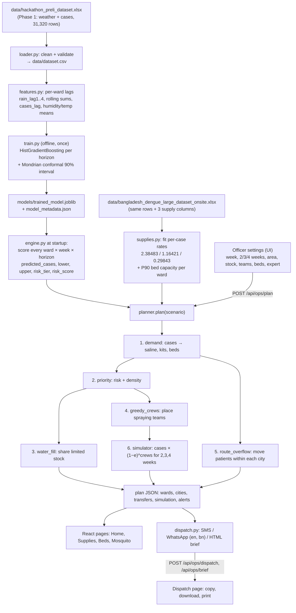

# DengueGuard AI — পুরো সিস্টেম সহজ বাংলায়

এই লেখাটা পড়ে আপনি যেন নিজের ভাষায় বলতে পারেন: ডেটা কোথা থেকে আসে, model কী করে, আর একটা SMS-এ "Saline 29/33" লেখাটা ঠিক কীভাবে তৈরি হলো।

---

## 1. DengueGuard AI আসলে কী করে

এক লাইনে: **বৃষ্টি, তাপমাত্রা, আর্দ্রতা আর আগের রোগীর সংখ্যা দেখে ৬০টি ওয়ার্ডে ২–৪ সপ্তাহ পরে কত ডেঙ্গু রোগী হবে তা অনুমান করে; তারপর সেই অনুমান থেকে ঠিক করে কোন ওয়ার্ডে কত স্যালাইন, কিট, শয্যা আর স্প্রে দল লাগবে, সীমিত মজুত কীভাবে ভাগ হবে, কোন রোগীকে কোন ওয়ার্ডে সরাতে হবে, আর প্রতিটি ওয়ার্ডকে কী বার্তা পাঠাতে হবে।**

- **Phase 1 (preliminary):** ডেটা পরিষ্কার করা, ওয়ার্ড-ভিত্তিক rainfall lag বের করা, প্রতিটি horizon-এর (2/3/4 সপ্তাহ) জন্য একটি ML model, risk tier (Low/Medium/High/Critical — UI-তে এখন "Very high"), 90% prediction interval, dashboard ও validation page।
- **Phase 2 (onsite):** নতুন কোনো forecasting model নয়। Phase 1-এর forecast-কে কাজের সিদ্ধান্তে বদলানো — allocation, overflow routing, what-if simulator, dispatch notice, আর offline চালানো।

## 2. পুরো data flow — একটা ছবিতে

### একই কথা সহজ বাংলায় (dataset থেকে SMS পর্যন্ত)

1. **ডেটা পড়া:** `loader.py` Excel পড়ে, তারিখ ঠিক করে, ডুপ্লিকেট থাকলে বাতিল করে, তারপর `data/dataset.csv` বানায়।
2. **Feature বানানো:** প্রতিটি ওয়ার্ডের জন্য আলাদাভাবে (`groupby('ward_id')`) গত ১–৪ সপ্তাহের বৃষ্টি, ২–৪ সপ্তাহের মোট বৃষ্টি, গত সপ্তাহের রোগী ইত্যাদি। শুধু অতীতের ডেটা ব্যবহার হয় — ভবিষ্যৎ ঢোকে না।
3. **Model:** প্রতিটি horizon-এর জন্য একটি model আগেই train করা আছে (`trained_model.joblib`)। Server চালু হলেই সব ওয়ার্ড × সব সপ্তাহ × ৩টি horizon একবারে score করে রেখে দেয় (`engine.py`)। এরপর প্রতিটি request শুধু টেবিল থেকে খোঁজা।
4. **Supply rule:** onsite workbook দেখায় supply = rate × রোগী, half-up round। আমরা এমন rate খুঁজেছি যা workbook-এর **প্রতিটি** row হুবহু মেলায়।
5. **Officer-এর settings:** কোন সপ্তাহ, কত সপ্তাহ সামনে, কোন এলাকা, কত মজুত, কত দল, কত শয্যা — UI থেকে `POST /api/ops/plan`-এ যায়।
6. **Plan:** `planner.plan()` forecast → supply demand → priority → সীমিত মজুত ভাগ → দল বসানো → শয্যার ঘাটতি হলে একই শহরে রোগী সরানো → spraying-এর what-if।
7. **বার্তা:** `dispatch.py` সেই একই plan থেকে প্রতিটি ওয়ার্ডের জন্য SMS/WhatsApp/printable brief বানায় — template দিয়ে, কোনো AI/LLM ছাড়া।
8. **Offline:** উপরের সবকিছু laptop-এর ভেতরেই চলে; কোথাও internet-এ যাওয়া হয় না।

## 3. Frontend কীভাবে backend-এর সাথে কথা বলে

- Frontend: React 19 + TypeScript + Vite। Build হওয়া ফাইল (`frontend/dist`) FastAPI নিজেই serve করে — তাই একটাই server, একটাই port (8000)।
- **সপ্তাহ, horizon, শহর** থাকে URL-এ (`?city=&ward=&asOf=&h=`) — link share করলে একই জিনিস খোলে (`state/AppData.tsx` → `useFilters`)।
- **বাকি settings** (stock, teams, beds, expert) থাকে `state/Ops.tsx`-এ, browser-এর localStorage (`dg.ops.v1`)-এ মনে রাখা হয়।
- `usePlanParams()` এই দুটো মিলিয়ে request body বানায়; `usePlan()` ২২০ ms অপেক্ষা করে (টাইপ করার সময় প্রতিটি অক্ষরে request যেন না যায়), তারপর `api.opsPlan()` → `POST /api/ops/plan`।
- `services/api.ts`-এর `post()` একই body-র উত্তর cache করে রাখে, তাই একই plan একাধিক জায়গায় লাগলেও (plan bar, page) server-এ একবারই যায়।
- **Supplies, Beds, Mosquito, Home, Dispatch — সবাই একই `usePlanParams()` ব্যবহার করে**, তাই সব page একই scenario দেখায়। Dispatch page একই params-এর সাথে `lang`, `only_flagged` যোগ করে `POST /api/ops/dispatch` ডাকে; brief-এর জন্য `POST /api/ops/brief` (সাথে `brief_city`)।

## 4. ML model কীভাবে prediction দেয়

- **Input feature (২৭টি, ৬টি দলে):** rainfall ৯টি (এই সপ্তাহ, lag 1–4, ২/৩/৪ সপ্তাহের যোগফল, lag1–4-এর যোগফল), temperature ৫টি, humidity ৩টি, recent cases ৪টি (এখন, lag1, lag2, ৪ সপ্তাহের গড়), ward vulnerability ৪টি (density, water-logging, sanitation, city), seasonality ২টি (target সপ্তাহের sin/cos)।
- **কোন feature সবচেয়ে গুরুত্বপূর্ণ (validation MAE কতটা বাড়ে যদি দলটা এলোমেলো করা হয়):** h=2-এ rainfall +1.73 (সবচেয়ে বড়), humidity +0.64; h=4-এ seasonality +1.18, rainfall +0.72। অর্থাৎ বৃষ্টির lag-ই মূল চালক — Phase 1 brief-এর "2-to-4-week lag" ধারণার সাথে মেলে।
- **Target:** একই ওয়ার্ডে t+h সপ্তাহের `dengue_cases`।
- **Model বাছাই:** তিনটি candidate (HistGradientBoosting-Poisson, HistGradientBoosting-squared-error, Poisson GLM) — 2023 সালের validation MAE-তে যে সবচেয়ে ভালো সেটা। ফল: h=2 ও h=3 → `hgb_squared_error`, h=4 → `hgb_poisson`।
- **Chronological split (target তারিখ অনুযায়ী):** train ≤ 2022 (h=2-তে ২১,৫৪০ row), validation 2023 (৩,১২০), test 2024–2025 (৬,৩০০)।
- **Test ফল:** MAE 1.05 / 1.06 / 1.16 রোগী (h=2/3/4); সহজ baseline (গত ৪ সপ্তাহের গড়) 1.73 / 1.94 / 2.15। 90% interval-এর আসল coverage 92.4% / 93.9% / 94.0%।
- **Risk tier:** training সময়ের সাপ্তাহিক রোগীর 70/85/95 percentile → ২, ৭, ১৩ রোগী। Predicted < 2 = Low, 2–7 = Medium, 7–13 = High, ≥ 13 = Critical ("Very high")। `risk_score = min(100, 100 × predicted / 20)` (২০ = training-এর P99)।

## 5. Prediction → supply demand → allocation → transfer → mosquito → message

| ধাপ | কী হয় | কোথায় |
|---|---|---|
| Forecast | ওয়ার্ড-সপ্তাহ-horizon অনুযায়ী `predicted_cases` (ও interval) | `engine.py` |
| Planning cases | "A normal week" = point forecast; "A bad week" = 90% interval-এর upper bound | `planner.py` লাইন 159–161 |
| Supply demand | প্রথমে পূর্ণ রোগী (half-up), তারপর `floor(rate × রোগী + 0.5)` | `supplies.py` লাইন 114–117 |
| Priority | `100 × (0.7 × risk_score/100 + 0.3 × density_norm)` | `planner.py` লাইন 160 |
| Allocation | water-filling: সব মজুত ব্যবহার, কেউ demand-এর বেশি না, বেশি priority = বেশি অংশ | `water_fill` |
| Crews | প্রতিটি দল সেই ওয়ার্ডে যায় যেখানে পরের দলটি সবচেয়ে বেশি রোগী ঠেকায় | `greedy_crews` |
| Beds | প্রতি শহরে আলাদা: বেশি excess → কম load-এর ওয়ার্ড | `route_overflow` |
| Simulator | cases × (1 − e)^দল, ২/৩/৪ সপ্তাহের প্রতিটিতে; তারপর আবার bed ও saline | `planner.py` লাইন 173–174, 267–297 |
| Alerts | ঘাটতি থাকলে flag; severity warning/critical | `planner.py` লাইন 238–265 |
| Messages | একই plan থেকে template | `dispatch.py` |

বিস্তারিত সূত্র ও আসল সংখ্যা: [ALGORITHM_WALKTHROUGHS.md](ALGORITHM_WALKTHROUGHS.md)।

## 6. পুরোটা offline কীভাবে চলে

- Model ফাইল (`models/trained_model.joblib`) ও দুটো dataset repo-তেই আছে; server চালুর সময় load হয়।
- Backend-এ কোনো network library নেই; কোনো LLM API নেই। বার্তা template দিয়ে তৈরি।
- Fonts build-এর ভেতরে (`frontend/dist/assets/*.woff2`); কোনো Google Fonts বা CDN নেই।
- Demo login backend-এর ভেতরেই (`/api/auth/demo`)।
- **কিন্তু:** Vercel-এর live site internet ছাড়া খুলবে না — offline demo হবে laptop-এর local app দিয়ে। আর offline অবস্থায় `start.ps1` নয়, সরাসরি `uvicorn` চালান (কারণ `start.ps1` `npm ci` চালায়)। বিস্তারিত: [STRESS_TEST_MATRIX.md](STRESS_TEST_MATRIX.md)।

---

## 7. Dataset — প্রতিটি কলাম

দুটো dataset-ই ৩১,৩২০ row: ৬০টি ওয়ার্ড × ৫২২ সপ্তাহ (2016-01-04 থেকে 2025-12-29)। শহর: Dhaka North ২০, Dhaka South ২০, Chattogram ১০, Gazipur ৫, Narayanganj ৫। আমরা যাচাই করেছি: onsite-এর `dengue_cases` Phase 1-এর সাথে **হুবহু এক**; নতুন কলাম মাত্র তিনটি।

| কলাম | মানে | ধরন |
|---|---|---|
| `date` | সপ্তাহের সোমবার | দেওয়া তথ্য |
| `city`, `ward_id` | শহর ও ওয়ার্ড | দেওয়া তথ্য |
| `population_density_sqkm` | জনঘনত্ব (১৮,৩১৪ – ৭৪,২৫২) | দেওয়া তথ্য (প্রতি ওয়ার্ডে স্থির) |
| `water_logging_risk_index` | জলাবদ্ধতার ঝুঁকি | দেওয়া তথ্য |
| `sanitation_score` | পরিচ্ছন্নতা | দেওয়া তথ্য |
| `avg_temp_c`, `max_temp_c`, `min_temp_c` | তাপমাত্রা | দেওয়া তথ্য |
| `rainfall_mm` | সাপ্তাহিক বৃষ্টি | দেওয়া তথ্য |
| `relative_humidity_pct` | আর্দ্রতা | দেওয়া তথ্য |
| `dengue_cases` | সেই সপ্তাহের রোগী (গড় ২.৬৪, সর্বোচ্চ ৪১, অর্ধেক সপ্তাহে ০) | দেওয়া তথ্য — model-এর target |
| `saline_bags_needed` *(onsite)* | স্যালাইন দরকার | দেওয়া তথ্য — কিন্তু আসলে রোগীর একটা নির্দিষ্ট গুণিতক |
| `diagnostic_kits_needed` *(onsite)* | পরীক্ষার কিট দরকার | একই |
| `hospital_beds_required` *(onsite)* | শয্যা দরকার | একই |

**Dataset-এ যা নেই:** হাসপাতালের আসল শয্যা সংখ্যা, মজুত (stock), স্প্রে দলের সংখ্যা, কোনো spraying/fogging/larvicide-এর রেকর্ড বা তার ফল। (যাচাই: "spray/crew/fog/larv/interven/capacity/stock" নামের কোনো কলাম নেই।) তাই এগুলো সবই **অনুমান বা ব্যবহারকারীর input**।

## 8. প্রতিটি গুরুত্বপূর্ণ সংখ্যা — কোথা থেকে আসে, কতটা বিশ্বাসযোগ্য

| সংখ্যা | উৎস | সূত্র | সীমাবদ্ধতা |
|---|---|---|---|
| Predicted cases | ML model (Phase 1) | HistGradientBoosting, প্রতি horizon-এ একটি | ভবিষ্যদ্বাণী — গড় ভুল ~১ রোগী |
| 90% interval | Mondrian split-conformal, 2023-এর residual থেকে | prediction ± q̂ (৪টি bin) | ঐতিহাসিক coverage 92–94%; ভবিষ্যতে নিশ্চিত নয় |
| Risk tier | training-এর case quantile | < 2 / 2–7 / 7–13 / ≥ 13 রোগী | prototype threshold, সরকারি নয় |
| Risk score | model | min(100, 100 × pred / 20) | ২০-এর বেশি রোগী হলেই 100 |
| Supply rates | onsite workbook থেকে fit | saline 2.38483, kits 1.16421, beds 0.29843 | workbook-এর ১০০% row মেলে; বাস্তব চিকিৎসা নির্দেশিকা নয় |
| Rounding | workbook-এর নিয়ম | প্রথমে রোগী half-up, তারপর `floor(rate × রোগী + 0.5)` | — |
| Bed capacity | **অনুমান** | প্রতি ওয়ার্ডে ঐতিহাসিক শয্যা-চাহিদার P90, উপরে round, কমপক্ষে ১ (মোট ১৭১) | আসল হাসপাতাল তথ্য নয়; editable |
| Stock | **ব্যবহারকারী** | demand-এর ৩০–১০০% (PDF-এর নিয়ম); UI-তে স্যালাইন ব্যাগ টাইপ করলে % এ রূপান্তর | আসল মজুত নয়; saline ও kit একই % পায় |
| Spraying teams | **ব্যবহারকারী** | ০–২০০ (API ০–৫০০) | — |
| Effect per team | **ব্যবহারকারীর অনুমান** | default 10%; n দল → রোগী × 0.9ⁿ | dataset-এ কোনো প্রমাণ নেই; causal নয় |
| Priority | হিসাব | 100 × (0.7 × risk/100 + 0.3 × density_norm) | 0.7/0.3 একটি নীতিগত পছন্দ, data থেকে শেখা নয় |
| Severity | হিসাব | ঘাটতি = warning; শয্যাহীন রোগী বা < 50% (উচ্চ ঝুঁকিতে < 75%) = critical | 30% মজুতে সব ওয়ার্ড critical |
| Simulated reduction | হিসাব (forecast × assumption) | base × (1 − e)^দল | what-if, পর্যবেক্ষিত ফল নয় |

### চারটি জিনিস কখনো গুলিয়ে ফেলবেন না

1. **Predicted cases** — model-এর ভবিষ্যদ্বাণী (মাপা ভুল সহ)।
2. **Estimated intervention impact** — সেই ভবিষ্যদ্বাণীর উপর আমাদের ধরে নেওয়া % (যেমন ১০%/দল)।
3. **Actual observed intervention outcome** — বাস্তবে spraying করে কী হয়েছিল। **আমাদের কাছে এই ডেটা নেই।**
4. **Unsupported causal claim** — "১২টি দল ৪৬ জনকে বাঁচাবে" এমন নিশ্চিত দাবি। **এটা বলা যাবে না।** বলতে হবে: "যদি প্রতিটি দল ১০% কমায়, তাহলে প্রায় ৪৬ জন কম হতে পারে।"
